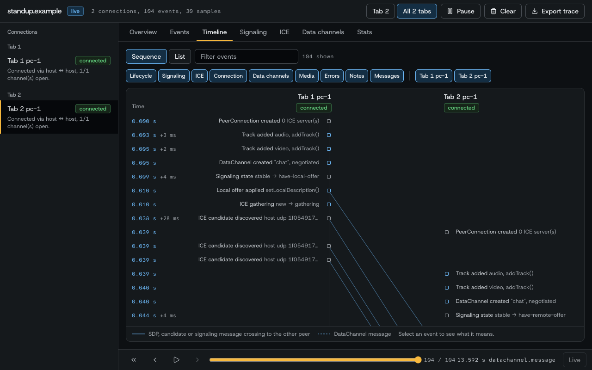
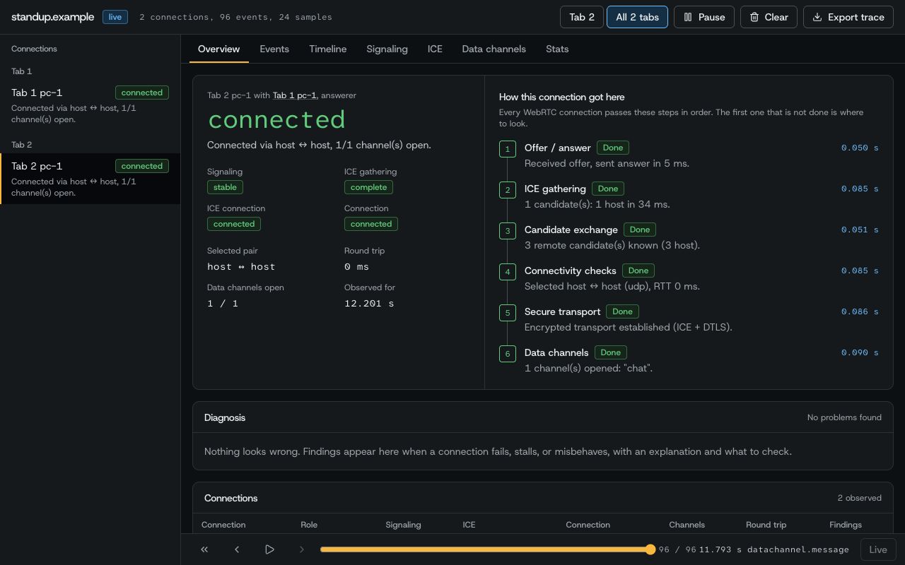
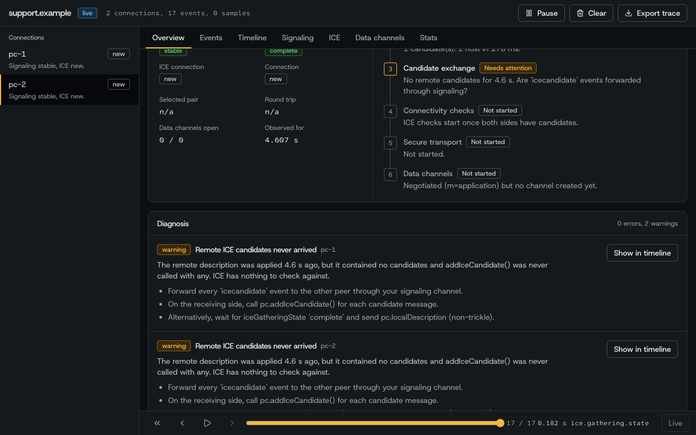
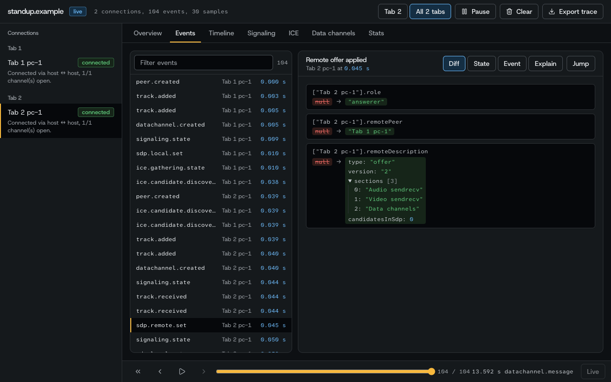
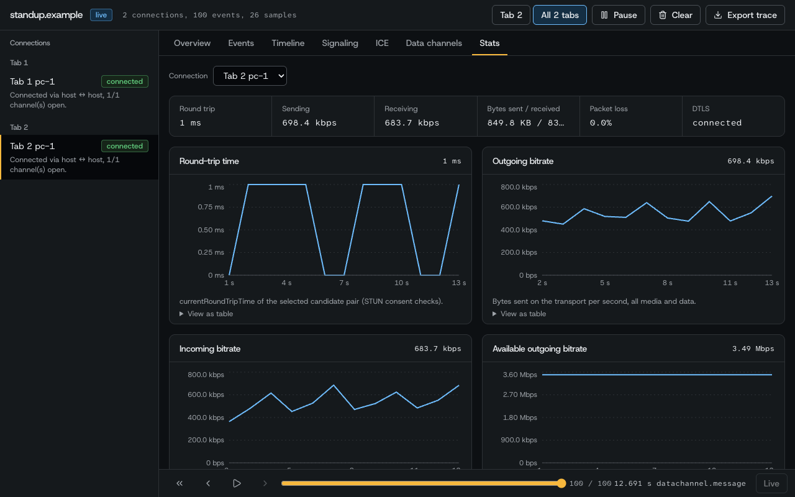
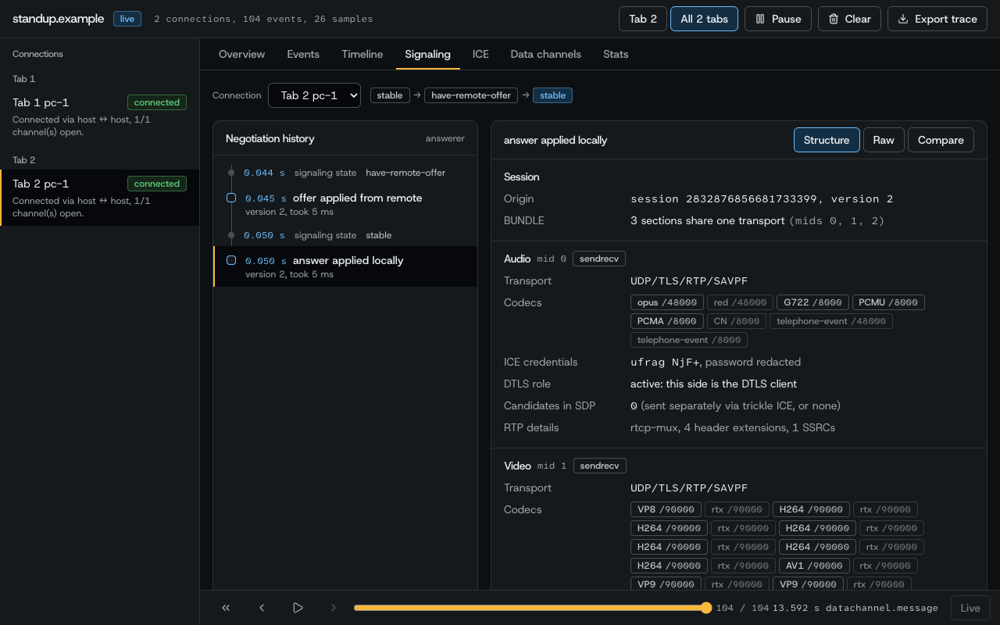
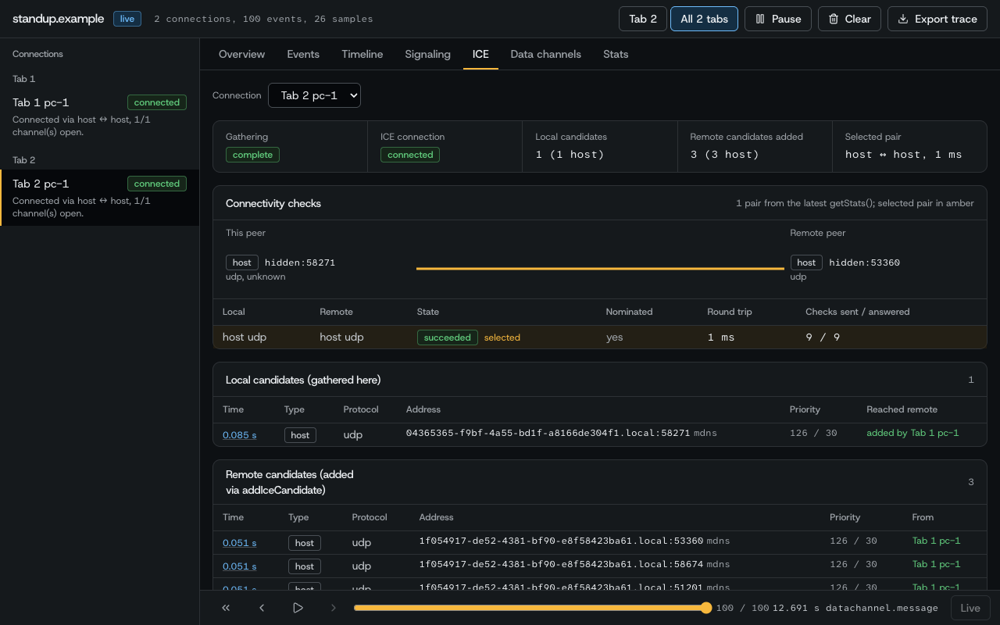

<div align="center">


# RTC Inspector

**See what every WebRTC connection on a page is doing, and why it failed.**

A Chrome extension that records every `RTCPeerConnection` and `RTCDataChannel` on any page, draws the call as a sequence diagram, and explains problems in plain language. No code changes. Nothing leaves your browser.

[Install](#install) · [Features](#features) · [How to use](#how-to-use) · [Privacy](#privacy-and-permissions) · [FAQ](#faq) · [SDK](#embed-it-in-your-app) · [Development](#development) · [License](#license)

[](https://github.com/LitHaxor/RTC-inspector/actions/workflows/ci.yml)


[](LICENSE)

</div>

<br>



## Why RTC Inspector

WebRTC fails quietly. A candidate that never got forwarded, an answer lost in signaling, or a data channel created one line too late all look the same from the outside: nothing connects. `chrome://webrtc-internals` gives you the raw API calls and stats. RTC Inspector turns them into a picture of the call and tells you which step broke:

- **It explains, not just records.** Each connection is shown as six steps, from offer/answer to open data channels, and the first step that isn't done is where to look. Diagnosis rules name the likely cause and say what to check.
- **It shows both ends.** When each participant of a call is a tab of the same site, their recordings are merged, so the offer leaving one tab and arriving in the other is a single arrow.
- **It needs nothing from your app.** It works on localhost, staging and production pages alike, with no SDK and no build step.

## Features

<table>
<tr>
<td width="50%" valign="top">

<p><b>Overview.</b> State, selected candidate pair, round-trip time, and how far the connection got through its six lifecycle steps.</p>
</td>
<td width="50%" valign="top">

<p><b>Diagnosis.</b> Findings in plain language with the evidence and what to check, such as candidates that were never forwarded.</p>
</td>
</tr>
<tr>
<td width="50%" valign="top">

<p><b>Events and time travel.</b> Every WebRTC event in order, with a diff of what it changed. Scrub the slider to see every view as it was at that moment.</p>
</td>
<td width="50%" valign="top">

<p><b>Live stats.</b> Round-trip time, outgoing and incoming bitrate, available bandwidth, packet loss and DTLS state, sampled every second.</p>
</td>
</tr>
<tr>
<td width="50%" valign="top">

<p><b>Signaling.</b> Negotiation history, each SDP broken down by media section, the raw text, and a diff between descriptions.</p>
</td>
<td width="50%" valign="top">

<p><b>ICE.</b> Local and remote candidates, connectivity checks per candidate pair, and the selected path.</p>
</td>
</tr>
</table>

Also included: a **Data channels** view with every channel's settings and a message log (direction, size, delivery time), a **Timeline** in sequence or list form filterable by category and peer, and **Export trace** to save the recording as a JSON file.

## Install

### From the Chrome Web Store

<!-- Replace this paragraph with the listing link and a Web Store badge once the listing is approved. -->
The listing is in review. Until it is live, install from a release zip or from source.

### From a release zip

1. Unzip `rtc-inspector-<version>.zip` into a folder you will keep.
2. Open `chrome://extensions` and turn on **Developer mode**.
3. Click **Load unpacked** and choose the folder.

### From source

```sh
git clone https://github.com/LitHaxor/RTC-inspector.git
cd RTC-inspector
pnpm install
pnpm package:extension          # builds, checks and zips the extension
```

Load `packages/extension/dist` with **Load unpacked** as above. After rebuilding, click the reload icon on the extension's card.

Requires Chrome 111 or later. Other Chromium browsers may work but are not tested.

## How to use

1. **Open a page that uses WebRTC.** To try it, open the [WebRTC samples data channel demo](https://webrtc.github.io/samples/src/content/datachannel/basic/) and click **Start**.
2. **Watch the icon.** It turns blue on pages that use WebRTC and stays gray everywhere else. The badge counts open connections; hover for open and closed totals.
3. **Click the icon** to inspect the tab in a popup. **Window** and **Tab** open a full-size inspector, reusing one that is already open.
4. **Or use DevTools.** Open DevTools on the page and choose the **RTC Inspector** panel.

Every connection is listed in a side rail (or a row above the tabs in narrow layouts). Until you pick one, the inspector follows the first connection that is still open, so after a hang-up and redial it shows the new call.

### The views

| Tab | What it shows |
| --- | --- |
| **Overview** | Connection state, the selected path, lifecycle steps, diagnosis findings, and every connection on the page. |
| **Events** | The action log. Select an event for **Diff** (what changed), **State** (every connection right after it), **Event** (its data), **Explain** (what it means) and **Jump** (time travel to it). Arrow keys move through the list. |
| **Timeline** | One lane per connection, with offers, answers, candidates and DataChannel messages drawn between sender and receiver. |
| **Signaling** | Signaling-state path, negotiation history, and each description's structure, raw SDP and diff. |
| **ICE** | Gathering and connection state, local and remote candidates, candidate pairs and checks. |
| **Data channels** | Channels with their settings, state and counters, and a message log. |
| **Stats** | Live `getStats()` metrics and charts, each with a table view. |

The slider at the bottom is **time travel**: step, replay, or jump to any event, and every tab shows the session as it was right after it. Recording continues meanwhile; **Live** returns to the present.

### Calls across tabs

When participants meet through a signaling server, each one is usually a tab, and each tab records only its own end. When more than one tab of the same site has a recording, the inspector merges them:

- connections are named by tab ("Tab 1 pc-1", "Tab 2 pc-1") and paired through the SDP session id;
- the timeline draws the offer, the answer and every DataChannel message crossing from one tab to the other;
- **Tab N** and **All N tabs** in the top bar switch between one tab and the merged view, and the choice is remembered.

Tabs are numbered in the order they were opened. A tab that reloads starts its part of the recording over; a tab that closes keeps what it recorded. Peers in another browser or on another machine can't be read from here: export a trace on each side instead.

## Privacy and permissions

**RTC Inspector does not collect, transmit, sell or share any data.** There is no account, no analytics and no server. The full policy is in [PRIVACY.md](PRIVACY.md).

- The recording lives in the page's own memory (up to 20,000 events) and is gone when the page reloads or closes.
- At capture time, IP addresses are shortened (`192.168.x.x`, `203.x.x.x`; mDNS names are kept), `a=ice-pwd` values are removed, and TURN passwords are never recorded.
- DataChannel messages are recorded as direction, size and a 200-character preview.
- Scripts, styles and fonts are all packaged with the extension. It makes no network requests, and an end-to-end test installs the store package and checks exactly that.
- **Export trace** saves a file only when you click it.

| Permission | Why |
| --- | --- |
| Content scripts on `http://*/*` and `https://*/*` at `document_start` | A page's WebRTC can only be observed from inside the page, before its own code creates a connection. |
| Host access to `http://*/*` and `https://*/*` | To read the recording when you open the inspector, update the badge, and attach to tabs that were open before installation. |
| `scripting` | To run the read-only function that returns a tab's recording to the inspector. |

## FAQ

<details>
<summary><b>The icon stays gray on a page that uses WebRTC.</b></summary>

The page created its connections before the extension was attached, or inside an iframe. Tabs that were already open when the extension was installed or updated are attached automatically, but only connections created after that are recorded. Reload the page and start the call again. Only the top frame of a page is recorded.
</details>

<details>
<summary><b>Can it change how my app behaves?</b></summary>

It is designed not to. Methods are wrapped on each connection instance, never on the prototype. Return values, resolutions and rejections pass through unchanged, `instanceof RTCPeerConnection` keeps working, `on*` handlers you set keep working, and an exception inside the inspector never reaches your code. The cost is one `getStats()` call per open connection per second and an in-memory event buffer.
</details>

<details>
<summary><b>Why can't I inspect chrome:// pages or the New Tab Page?</b></summary>

Chrome does not allow any extension to run on `chrome://` pages, the New Tab Page or the Chrome Web Store. The inspector says so when you open it there.
</details>

<details>
<summary><b>How do I share a recording?</b></summary>

Click **Export trace** in the top bar to save a JSON file. Open it in the trace viewer that comes with this repository (`pnpm dev`, then <http://localhost:3100/viewer>), or render it in your own app with `<RTCInspector trace={parseTrace(json)} />`.
</details>

<details>
<summary><b>Does it work with audio and video calls?</b></summary>

Yes. Tracks, media sections in SDP and media statistics are recorded alongside data channels. Audio and video content is never read.
</details>

## What it diagnoses

Rules read the recorded session and report findings with an explanation, suggestions and the events that prove it:

- negotiation succeeded but ICE found no path (the classic `failed` after `stable`)
- remote candidates never arrived, or were rejected by `addIceCandidate()`
- no local candidates (including relay-only without TURN), host-only gathering, STUN/TURN error codes, slow gathering
- answer never arrived, remote offer never answered, slow connectivity checks, disconnection
- media sections rejected by the answer
- DataChannel created after negotiation, channel never opening, `send()` before open, backpressure
- relayed traffic, high round-trip time, packet loss

The rules live in [packages/core/src/diagnostics.ts](packages/core/src/diagnostics.ts). Each is a small function; add new ones to `RULES`.

## What is recorded

| Area | Events |
| --- | --- |
| Lifecycle | `peer.created` (configuration, initial state), `peer.closed` |
| Signaling | `offer.created`, `answer.created`, `sdp.local.set`, `sdp.remote.set` (with duration), `signaling.state`, `negotiation.needed`, `signaling.message` (annotations) |
| ICE | `ice.candidate.discovered`, `ice.candidate.added`, `ice.candidate.error`, `ice.gathering.state`, `ice.connection.state`, `ice.restart`, `ice.pair.selected` |
| Connection | `connection.state` |
| Data channels | `datachannel.created`, `.received`, `.open`, `.closing`, `.close`, `.error` (including `send()` failures), `.message` (both directions: size, type, sequence, preview) |
| Media | `track.added`, `track.received` |
| Errors | `api.error` for any intercepted method that rejects or throws |
| Stats | `stats.sample` every second: selected pair, every candidate pair, RTT, bitrates, loss, DTLS state, data channel counters |

Every event has `id`, `seq`, `timestamp` (epoch ms), `peerId`, `type`, `category`, typed `details`, and an optional `correlationId` linking the same thing seen on two peers. The schema is in [packages/core/src/types.ts](packages/core/src/types.ts).

## Embed it in your app

The extension is built on an SDK you can use directly, to show the inspector inside your own app, log events to the console, or export traces from tests:

```tsx
import { installGlobalInspector } from "@rtc-inspector/sdk";
import { RTCInspector } from "@rtc-inspector/ui";
import "@rtc-inspector/ui/styles.css";

// Before your app creates any connection: observes every RTCPeerConnection from here on.
const inspector = installGlobalInspector();

<RTCInspector session={inspector} />;
```

Explicit observation, signaling annotations, options and interception rules are documented in [packages/sdk/README.md](packages/sdk/README.md).

## Development

```
packages/
├── core/        framework-independent: observers, event schema, SDP/ICE parsers,
│                stats collector, projection, flows, diagnostics, trace format
├── sdk/         public entry point: createInspector, patchGlobal, auto-install,
│                console logger, trace download
├── ui/          React inspector (Zustand store + Tailwind), subscribes to any event source
├── extension/   the Chrome extension: page recorder, background worker, popup,
│                inspector window, DevTools panel, store packaging and assets
└── playground/  Next.js app: playground, embedded demo, trace viewer, e2e tests
```

```sh
pnpm install
pnpm dev                     # playground on http://localhost:3100
pnpm test                    # unit tests (Vitest)
pnpm test:coverage           # with the coverage gate (lines 85%, branches 75%)
pnpm typecheck               # all packages
pnpm e2e                     # playground scenarios against real WebRTC in Chrome
pnpm --filter @rtc-inspector/extension e2e    # the built extension in Chrome for Testing
pnpm build                   # every package
```

The playground runs real peer connections in one tab through a simulated signaling server, with scenarios that reproduce common bugs: candidates never forwarded, the answer lost in signaling, candidates overtaking the offer, a channel created after the offer, `send()` before open, unreachable STUN and TURN, and relay-only without TURN. It also has an embedded-mode demo and the trace viewer.

### How the extension works

A content script runs in each page's own JavaScript world at `document_start`, before the page's code, and installs the recorder (`patchGlobal()`), so every connection the page creates is observed. The inspector reads that recording with `chrome.scripting.executeScript` (popup and window) or `chrome.devtools.inspectedWindow.eval` (DevTools panel). A second, isolated content script only forwards the connection count to the background worker for the badge. Toolbar icons are rendered by `packages/extension/scripts/make-icons.mjs`.

### Releasing to the Chrome Web Store

Releases are automated. Every pull request and push to `main` runs [CI](.github/workflows/ci.yml): typecheck, unit tests with the coverage gate, build, the store zip, and both end-to-end suites on real Chrome. Pushing a version tag runs [Release](.github/workflows/release.yml), which reruns CI and uploads the tested zip to the Chrome Web Store through its API, then attaches it to a GitHub release:

```sh
# after bumping version in packages/extension/public/manifest.json and package.json
git tag v0.2.0 && git push origin v0.2.0
```

[RELEASING.md](RELEASING.md) covers the one-time setup (first manual upload, a Google Cloud service account, GitHub environment secrets), staged publishing and troubleshooting. To build the zip locally, run `pnpm package:extension`. To regenerate the listing images, run `node packages/extension/scripts/store-assets.ts`. The listing copy is in [packages/extension/store/LISTING.md](packages/extension/store/LISTING.md).

## Roadmap

- Remote monitoring over WebSocket. An `InspectorSession` already exposes `subscribe` and `ingest`, so a transport is a thin layer on both sides.
- Persisting sessions in IndexedDB.
- AI-written explanations on top of the rule findings.

## Contributing

Bug reports and pull requests are welcome in the [issue tracker](https://github.com/LitHaxor/RTC-inspector/issues). Please run `pnpm test:coverage`, `pnpm typecheck` and the e2e suites before opening a pull request, and include tests for new behavior.

## License

[MIT](LICENSE) © 2026 LitHaxor
